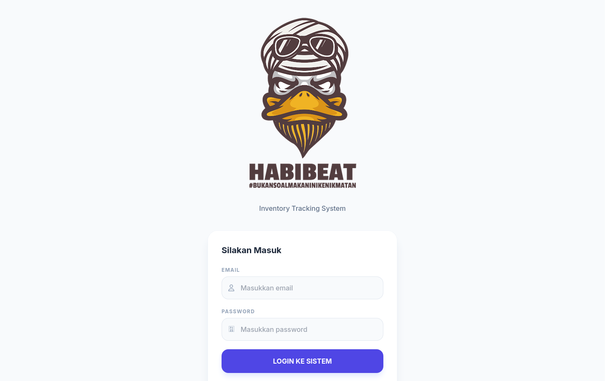
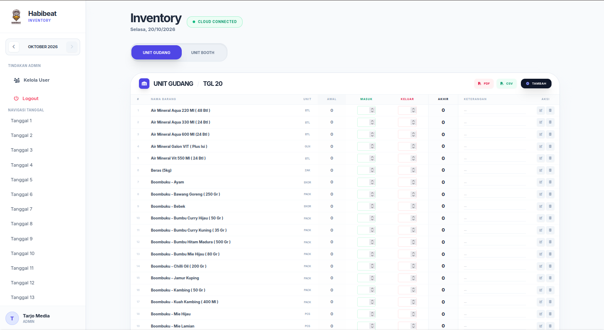

# Habibeat — Inventory Daily Tracker

Aplikasi web untuk mencatat stok harian gudang dan booth, menghubungkan **stok akhir hari ini** dengan **stok awal hari berikutnya** secara otomatis. Dirancang untuk operasional restoran/katering dengan dua unit (Gudang & Booth) dan beberapa staf yang menginput bersamaan.

Dibangun sebagai SPA (React + Vite) dengan backend **Firebase** (Auth + Firestore) yang bisa diganti cukup lewat lapisan `lib/api.ts`.

---

## Fitur Utama

- **Pencatatan stok harian** — Stok Awal, Masuk, Keluar, dan Keterangan per barang, per tanggal.
- **Carry-over otomatis** — Stok akhir otomatis menjadi stok awal hari berikutnya, dan stok akhir bulan menjadi stok awal bulan berikutnya.
- **Dua unit terpisah** — Gudang dan Booth punya data masing-masing.
- **Realtime multi-user** — Perubahan langsung tersinkron ke semua perangkat lewat Firestore `onSnapshot`.
- **Status sinkronisasi per sel** — Indikator kecil (`...` / `✓` / `!`) di tiap input menandakan proses simpan.
- **Mode arsip (read-only)** — Bulan yang sudah lewat otomatis terkunci, tidak bisa diubah.
- **Navigasi bulan & tanggal** — Hari di masa depan terkunci; lihat data historis per bulan.
- **Manajemen pengguna** — Admin bisa menambah, menonaktifkan, dan menghapus user; role `admin` / `staff`.
- **Manajemen produk** — Tambah/edit/hapus barang, impor massal dari daftar bawaan Habibeat atau unggah CSV.
- **Ekspor laporan** — Unduh tabel harian sebagai **PDF** dan **CSV**.
- **Ringkasan** — Kartu statistik Total Item, Stok Masuk, Stok Keluar, dan Nilai Stok Akhir.

---

## Tampilan

### Halaman Login

Form masuk memakai **email** dan password. Sesi diurus Firebase Authentication (password di-hash, tidak disimpan di database aplikasi).



### Dashboard Inventory

Tampilan utama setelah login. Bagian-bagiannya:

- **Sidebar kiri** — logo, navigator bulan (tombol ‹ ›), menu **Kelola User** (khusus admin), tombol **Logout**, dan daftar **Tanggal 1–31** untuk berpindah hari. Tanggal di masa depan terkunci.
- **Header** — judul, tanggal aktif, dan indikator **Cloud Connected** (hijau) yang berubah jadi **Syncing...** (kuning) saat data sedang disimpan.
- **Pemilih unit** — tab **UNIT GUDANG** dan **UNIT BOOTH** untuk berpindah data antar unit.
- **Tabel stok** — kolom **#**, Nama Barang, Unit, **Awal**, **Masuk**, **Keluar**, **Akhir**, Keterangan, dan Aksi. Kolom **Masuk**/**Keluar** bisa diisi langsung; kolom **Akhir** dihitung otomatis (Awal + Masuk − Keluar). Tombol **PDF** dan **CSV** mengekspor laporan harian, sedangkan **Tambah** (khusus admin) untuk menambah barang.
- **Info editor** — baris kecil di bawah pemilih unit menampilkan siapa yang terakhir mengubah data dan jamnya.



---

## Teknologi

| Bagian | Teknologi |
| --- | --- |
| Frontend | React 19 + TypeScript |
| Build tool | Vite 6 |
| Backend | Firebase — Authentication + Cloud Firestore |
| Styling | Tailwind CSS (via CDN) + Font Awesome |
| Ekspor | html2pdf.js |
| Hosting | GitHub Pages / Vercel |

---

## Struktur Proyek

```
.
├── App.tsx                     # Komponen utama: state, fetch data, carry-over, realtime
├── index.tsx                   # Entry point React
├── index.html                  # Shell HTML (CDN Tailwind, Font Awesome, html2pdf)
├── types.ts                    # Tipe data (User, Product, StockEntryRow, dll)
├── constants.tsx               # Helper format (mis. formatCurrency)
├── components/
│   ├── Layout.tsx              # Sidebar, navigasi bulan/tanggal, header
│   ├── Login.tsx               # Form login (email + password)
│   ├── InventoryTable.tsx      # Tabel stok + input + ekspor PDF/CSV
│   ├── StatsCards.tsx          # Kartu ringkasan
│   ├── ProductModal.tsx        # Modal tambah/edit produk
│   └── UserManagement.tsx      # Panel admin: user + impor produk
├── lib/
│   ├── api.ts                  # Lapisan data (seam) — dipakai seluruh UI
│   └── providers/
│       └── firebase.ts         # Implementasi provider Firebase
├── firestore.rules             # Aturan keamanan Firestore
├── .env.local                  # Konfigurasi lokal (di-ignore, tidak di-commit)
└── assets/                     # Logo & screenshot
```

Seluruh akses data lewat `lib/api.ts`. Komponen UI tidak pernah memanggil Firebase secara langsung.

---

## Memulai

### Prasyarat

- Node.js 18+ (disarankan 20+)
- npm
- Akun Firebase (gratis)

### Instalasi

```bash
git clone https://github.com/storyofgold/habibeat.git
cd habibeat
npm install
```

### Konfigurasi Environment

Buat `.env.local` (file ini di-ignore dan **tidak boleh** di-commit):

```
VITE_FIREBASE_API_KEY=
VITE_FIREBASE_AUTH_DOMAIN=
VITE_FIREBASE_PROJECT_ID=
VITE_FIREBASE_STORAGE_BUCKET=
VITE_FIREBASE_MESSAGING_SENDER_ID=
VITE_FIREBASE_APP_ID=
```

Nilai-nilainya didapat dari Firebase Console (langkah di bawah).

---

## Setup Firebase

1. Buka <https://console.firebase.google.com> → **Add project** (gratis).
2. **Project settings → Your apps → Web (`</>`)** → daftarkan app → salin objek `firebaseConfig`.
3. Isi enam nilai dari config tersebut ke `.env.local`.
4. **Build → Authentication → Sign-in method → Email/Password → Enable**.
5. **Build → Firestore Database → Create database** (mode production, pilih region).
6. **Firestore → tab Rules** → tempel isi `firestore.rules` → **Publish**.
   (Lewat CLI: `firebase deploy --only firestore:rules`.)
7. **Buat admin pertama** (manual, sekali saja):
   - **Authentication → Users → Add user** (email + password). Simpan **User UID**.
   - **Firestore → collection `users` → Add document**, **Document ID = UID** tadi, dengan field:

     | Field | Tipe | Nilai |
     | --- | --- | --- |
     | `username` | string | email admin (sama persis) |
     | `name` | string | nama tampilan, mis. `Admin Habibeat` |
     | `role` | string | `admin` |
     | `is_active` | boolean | `true` |

8. Login memakai email + password admin tersebut. User berikutnya ditambah dari menu **Kelola User**.

> Login memakai email asli (bukan username). Password di-hash dan sesi diurus Firebase Auth; role disimpan di dokumen Firestore `users/{uid}`.

### Menjalankan (development)

```bash
npm run dev
```

Buka <http://localhost:3000/habibeat/>.

---

## Build & Deploy

```bash
npm run build     # output ke dist/
npm run preview   # pratinjau hasil build
```

Vite menyematkan `.env.local` saat build, jadi **isi env dulu sebelum build**.

### GitHub Pages

`vite.config.ts` sudah memakai `base: "/habibeat/"`, cocok untuk Pages project site.

```bash
npm run build && npm run deploy
```

`npm run deploy` menjalankan `gh-pages -d dist` dan **tidak** build otomatis.

### Vercel

Import repo dari dashboard Vercel, set env yang sama di **Project Settings → Environment Variables**, lalu deploy. Framework terdeteksi otomatis sebagai Vite.

Untuk **Firebase Auth**, tambahkan domain hosting ke
**Authentication → Settings → Authorized domains** (mis. `storyofgold.github.io`, atau domain Vercel-mu), atau login akan gagal dengan `auth/unauthorized-domain`.

---

## Model Data (Firestore)

| Collection | Document ID | Field |
| --- | --- | --- |
| `users` | `{uid}` | `username`, `name`, `role`, `is_active` |
| `products` | auto | `name`, `unit`, `unit_price` |
| `daily_entries` | `{section}_{year}_{month}_{day}_{productId}` | `product_id`, `section`, `day`, `month`, `year`, `opening_stock`, `stock_in`, `stock_out`, `description`, `last_modified_by`, `last_modified_at` |

`section` bernilai `gudang` atau `booth`. ID `daily_entries` sengaja deterministik agar satu barang per tanggal hanya punya satu dokumen (idempoten saat disimpan ulang).

Aturan keamanan (`firestore.rules`) mewajibkan pengguna sudah login **dan** memiliki profil aktif. Hanya `admin` yang boleh mengelola `users` dan `products`.

---

## Mengganti Penyedia Database

Seluruh UI mengakses data melalui `lib/api.ts`:

```ts
import { firebaseProvider } from './providers/firebase';
export const api = firebaseProvider;
```

Untuk pindah ke provider lain, buat file yang mengekspor objek dengan nama fungsi yang sama (`login`, `logout`, `onAuthChange`, `listProducts`, `getEntries`, `subscribeEntries`, `upsertEntry`, `saveProduct`, `deleteProduct`, `importProducts`, `listUsers`, `createUser`, `setUserActive`, `deleteUser`), lalu ubah satu baris import di `lib/api.ts`. Tidak ada komponen UI yang perlu disentuh.

---

## Catatan & Batasan

- **Hapus user** hanya menghapus profil di Firestore; akun Auth-nya tetap ada (orphan) dan tidak bisa mengakses apa pun karena rules butuh profil aktif. Hapus manual dari Firebase Console bila perlu.
- **Pembuatan user** memakai instance Firebase sekunder (client-side) agar admin tidak ter-logout; untuk kebutuhan server-side, pindahkan ke Cloud Functions/Admin SDK.
- Kueri `daily_entries` hanya memakai filter kesetaraan (`month`, `year`) sehingga tidak memerlukan composite index.
- Menghapus produk tidak menghapus entri `daily_entries` terkait (data historis tetap tersimpan).
- Tailwind di-load dari CDN; untuk produksi serius sebaiknya dimigrasikan ke build-time (PostCSS/Tailwind CLI).

---

## Lisensi

Belum ditentukan. Tambahkan file `LICENSE` bila akan didistribusikan.
